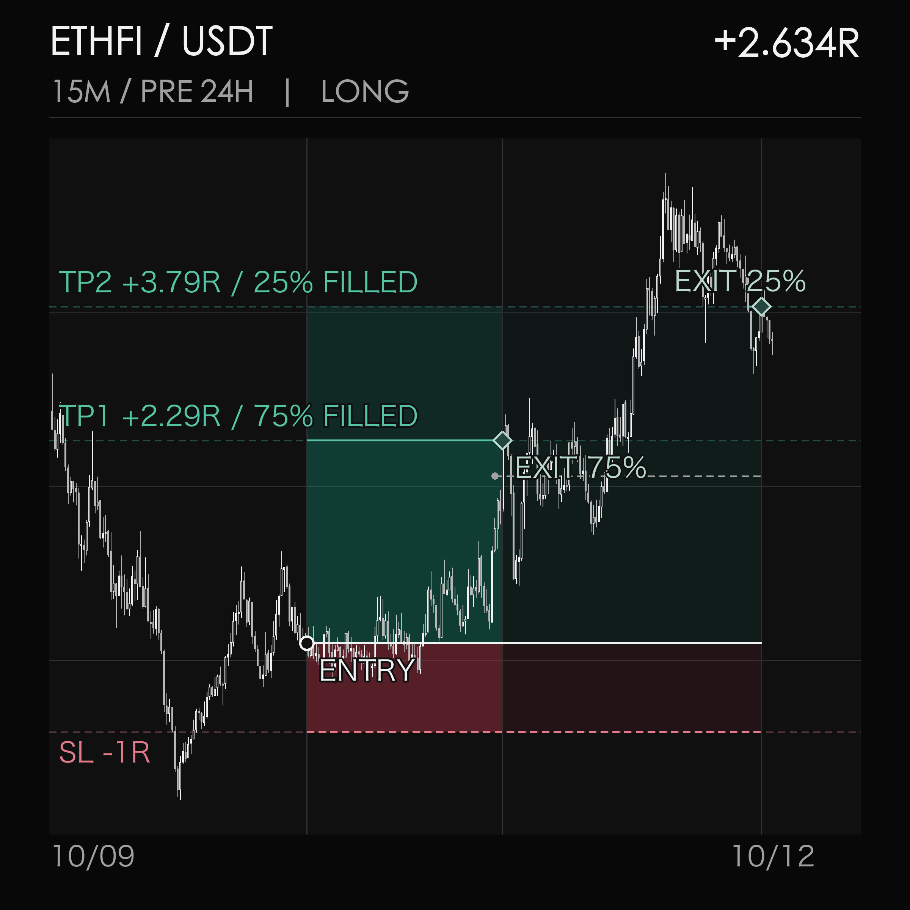

# OKX Trade Viz

A single, read-only CLI for turning your OKX trades into candlestick images. Each position gets up to eight views by default, from the 15-minute setup to 28 days of 4-hour context. Recorded TP/SL levels, partial exits and the whole-position net **R** are shown on the charts. If the original risk or account evidence cannot be verified, the label is `R UNAVAILABLE` instead of an estimated R.

This is a visualization tool, not an order manager. It does not place, amend or cancel orders.

## Example



This ETHFI-USDT-SWAP chart shows 24 hours of 15-minute pre-entry context. The red and green bands show the recorded stop and profit targets; the diamonds mark actual partial exits. TP1 closed 75% of the position, TP2 closed the remaining 25%, and the verified whole-position net result was +2.634R. The target labels describe planned price distance, not realized profit on their own.

## Run

Python 3.12+ and [`uv`](https://docs.astral.sh/uv/) are required.

```bash
uv sync
uv run okx-trade-viz --help
uv run okx-trade-viz --days 3 --env-file /path/to/existing/.env
```

For an installed command available outside the checkout, run `uv tool install .` from this directory, then `okx-trade-viz --help` anywhere.

Use an OKX API key with **read permission only**, and keep withdrawals and trading disabled. The credential file contains:

```dotenv
OKX_API_KEY='...'
OKX_API_SECRET='...'
OKX_API_PASSPHRASE='...'
OKX_DEMO=0
```

Restrict it with `chmod 600 /path/to/existing/.env`. The default credential location is `~/.config/okx-trade-viz/.env`; `--env-file` can point at an existing file without copying it. Credentials are never stored in the image output.

The default data directory is `~/.local/share/okx-trade-viz`. Account orders and fills are incrementally archived there so older trades are not lost when OKX's API history window advances. To choose a different private location, pass `--data-dir /path/to/private-data`. The CLI checks archive coverage and refuses to present incomplete reconstruction as a verified trade. Keep this directory backed up and do not commit it to Git.

To bring over an existing `okx-analysis` archive once, use an **empty** destination:

```bash
uv run okx-trade-viz --import-from /path/to/okx-analysis \
  --data-dir /path/to/new-private-data --env-file /path/to/existing/.env --days 3
```

This copies the two SQLite archives, their referenced raw snapshots and the candle cache, then continues with a normal read-only sync and render. It leaves the old directory untouched and does **not** copy credentials. Do not pass `--import-from` on later runs; use the same `--data-dir` to continue incremental sync. The import refuses a nonempty destination or raw references outside the old `data/` directory. Legacy balance and position-history payloads are omitted from migrated raw snapshots; the metadata and quality proof used by this CLI remain.

## Choose what to render

```bash
# One instrument; the account archive is still synced as a whole.
uv run okx-trade-viz --days 7 --instrument ETHFI-USDT-SWAP

# Several instruments, each with up to eight views.
uv run okx-trade-viz --days 7 \
  --instrument ETHFI-USDT-SWAP --instrument CRV-USDT-SWAP

# Choose exact intervals instead of the eight default structure views.
uv run okx-trade-viz --days 3 --bars 15m 4H

# Re-render solely from existing archives and candle caches; no API calls.
uv run okx-trade-viz --offline --days 3 --data-dir /path/to/private-data
```

`--structure` explicitly selects the eight-view default. `--bars` and `--structure` cannot be used together. `--output-dir` chooses a private image directory; an existing shared directory is rejected rather than having its permissions changed. `--relay` is optional and applies only to public candle fetching when direct access is unavailable.

Each run prints its output directory and writes a per-trade PNG series, `index.md` for browsing, and `manifest.json` with source/coverage metadata. A long-running position may have fewer than eight images: views requiring more than 720 candles are reported as skipped rather than silently coarsened. The recent window selects positions with an opening **or closing** fill in that period; it is not limited to positions opened during the window. A closed position's shaded exposure ends at its last exit, while candles continue to the latest complete bar for context.

An open position's R uses a verified current OKX position snapshot: realized net PnL plus unrealized mark-to-market PnL, divided by the original planned risk. It can change before final exit and excludes future exit costs. Closed-position R uses the final verified net result. TP/SL guide lines are recorded price references, not proof that child orders remained active unchanged.

## Repository layout

- `src/okx_trade_viz/cli.py` exposes the single `okx-trade-viz` command.
- `sync.py`, `archive.py`, `order_archive.py`, and `migrate.py` preserve the account evidence needed for later reconstruction.
- `trades.py` reconstructs positions; `candles.py`, `chart.py`, and `render.py` produce the image series.
- `tests/` checks the command, migration, view presets, and chart behavior without credentials.

## Verify locally

```bash
uv run python -m unittest discover -s tests
```

No API key is needed for the CLI help or offline tests.
